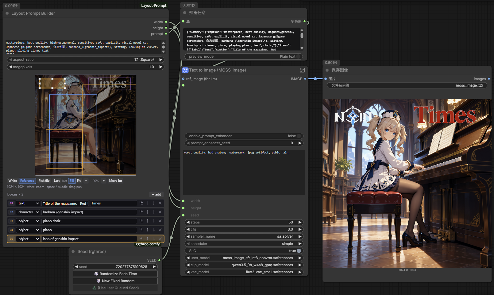

# Layout Prompt Builder for ComfyUI

**English** | [简体中文](README.zh-CN.md)



A ComfyUI custom node for building **MOSS-Image layout prompts** interactively. It combines the output-size selector, a box editor, and the layout-prompt serializer in one node: set the scene summary and output shape, draw boxes over a white canvas or a reference image, give every box a label and caption, and output `width`, `height`, and the layout prompt string.

It can replace `ResolutionSelector`, `CreateBoundingBoxes`, and `MOSSImageLayoutPrompt` in a MOSS workflow.

## Features

- Output shape from an aspect ratio and a megapixel target; both sides are rounded to multiples of 16.
- Draw, move, resize, duplicate, reorder, and delete boxes on a canvas that always represents the exact output rectangle.
- Per-box `label` (`character`, `object`, `text`), `caption`, and `text` for text items.
- White canvas, an uploaded reference image, or the last generated image as the background.
- Reference `Fill`/`Fit`, 50–800% zoom anchored at the pointer, and clamped panning.
- Undo/redo for layout and reference changes; selection is shared between the canvas and the list.
- Everything persists in the workflow; only reference descriptors are saved, never image bytes.

## Installation

1. Clone this repository into ComfyUI's `custom_nodes` directory:

   ```bash
   cd ComfyUI/custom_nodes
   git clone https://github.com/sjmind2/ComfyUI-Layout-Prompt.git
   ```

2. Restart the ComfyUI server and hard-refresh the browser (`Ctrl+F5`, or `Shift`+Reload).
3. Add **Layout Prompt Builder** under **model/conditioning/moss_image**.

There are no extra Python dependencies and no build step: `layout_core.py` is standard-library-only, `nodes.py` uses ComfyUI's V3 `comfy_api.latest` API, and the editor is plain ES modules. A recent ComfyUI is required (V3 node API and the recent core nodes used by the example).

## Example workflow

[Download the example workflow](examples/layout-prompt-moss-image.json). The screenshot above shows it editing the five-box piano scene next to the generated image.

The workflow uses:

- **This node** for the layout prompt and output size.
- An embedded **Text to Image (MOSS-Image)** subgraph built from core nodes (a recent ComfyUI is needed).
- [rgthree-comfy](https://github.com/rgthree/rgthree-comfy) for the `Seed (rgthree)` node.
- The models selected inside the subgraph: `moss_image_sft_int8_convrot.safetensors`, `qwen3.5_9b_w4a8_gptq.safetensors`, and `flux2-vae_small.safetensors`.

The screenshot used a private reference image, so it is **not bundled**: the workflow loads with a **white canvas** and all five boxes intact. Click `Pick file` to load your own reference, or keep the canvas white. The example is 1:1 at 1.0 MP with one `text` box, one `character` box, and three `object` boxes.

## Using the node

1. Set `summary` (the global scene/style caption), `aspect_ratio`, and `megapixels`.
   - Aspect ratios: `1:1 (Square)`, `2:3 (Portrait Photo)`, `3:2 (Photo)`, `3:4 (Portrait Standard)`, `4:3 (Standard)`, `9:16 (Portrait Widescreen)`, `16:9 (Widescreen)`, `21:9 (Ultrawide)`.
   - `megapixels` accepts 0.1–16.0 in steps of 0.1 (default 1.0; MOSS typically uses 1–2 MP).
   - Sides are rounded to multiples of 16. For example, 1:1 at 1.0 MP is 1024×1024, and 16:9 at 1.0 MP is 1360×768.
2. Draw boxes on the canvas and edit their rows in the box list. New boxes default to the `character` label with an empty caption.
3. Connect `width`, `height`, and `prompt` wherever the MOSS workflow expects the output size and layout string.

The canvas always represents the exact output rectangle, scaled to fit the node. The hint line below the toolbar shows the current output size and the transform shortcuts.

### Iterating on a layout

The node is built for fast repeat passes:

- **The body is over-stretched** → move the part boxes.
- **Parts merge, disappear, or are mistaken** → adjust the box caption and box size.
- **The subject count or features are wrong** → adjust the summary and add/remove boxes.
- Switch the background between white, a reference image, and the last generated image to keep iterating without rebuilding the graph.

### Keyboard focus

Editing shortcuts (nudge, delete, duplicate, undo/redo, `Esc`) fire while keyboard focus is anywhere in the panel: the canvas, a box row, a toolbar button, or the panel background. Clicking the canvas or a panel gap focuses the canvas; clicking a row body focuses that row. Inside caption/text inputs, keys behave as normal text editing (including the browser's native `Ctrl+Z`) and never edit the layout. The editor consumes the keys it handles, so the graph never sees them.

### Box editing

| Action | Control |
|---|---|
| Draw a box | Left-drag on empty canvas. A drag shorter than 3 display px counts as a click (deselect). The box is clamped to the canvas, appended to the list, and selected. |
| Move a box | Left-drag inside the box. |
| Resize a box | Drag one of the 8 handles (four corners and four edge midpoints) on the selected box. The minimum size is 3 display px. |
| Select | Click a box, or click a list row. Canvas and list share the selection; selecting on the canvas scrolls the row into view. |
| Deselect | `Esc` (with panel focus), or click empty canvas. |
| Add a box | `+ add` in the list header. Adds a centered 20% box (0–1000 bbox `[400,400,600,600]`) with label `character`, and focuses its caption field. |
| Edit a box | In its row: the label dropdown (`character`, `object`, `text`), the caption input, and a `text` input that appears only for `text` labels. Edits commit on blur or after a short typing pause. |
| Duplicate | `Ctrl+D` (panel focus), or the row's duplicate button. The copy keeps its size and shifts by 30 units when that fits; near the right/bottom edge it shifts 30 units the other way, and a full-frame box stays put. The copy is selected. |
| Reorder | The row's up/down buttons. List order is JSON item order and canvas paint order: later items draw in front, except the selected box, which is always painted last. |
| Delete | `Delete` or `Backspace` (panel focus), or the row's delete button. |
| Nudge | Arrow keys move the selected box 1 unit; `Shift`+arrows move it 10 units (the editor's 0–1000 coordinate space). |
| Undo / redo | `Ctrl+Z` / `Ctrl+Shift+Z` (the `Cmd` keys also work on macOS). |

### Reference view

| Action | Control |
|---|---|
| White / Reference | Toolbar toggle. View-only: it keeps the loaded reference and is not an undo step. |
| Pick file | Toolbar button. Uploads a local image and makes it the reference. |
| Use last | Toolbar button. Uses the last generated image as the reference; disabled until one is known. On load it recovers the newest image from ComfyUI's history, so it works after a reload or for images produced before the node existed. Enabled title: "Use the last generated image as the reference"; disabled title: "No generated image available yet — run the workflow". |
| Fill / Fit | Toolbar toggle. `Fill` covers the canvas and crops the overflow; `Fit` contains the whole image and letterboxes it. Both reset zoom to 100% and recenter. |
| Zoom reference | Mouse wheel over the canvas, anchored at the pointer; the `−` and `+` buttons step 10 percentage points. The `zoom %` label shows the current value. The wheel is always consumed by the editor, so the graph never zooms. |
| Pan reference | Toggle `Move bg` and drag, hold `Space` and left-drag, or middle-drag. |
| Move bg | Toolbar toggle. While active, left-dragging pans the reference instead of editing boxes. |

## Reference image

The reference sits under the boxes and is dimmed to about 55% brightness so the layout stays readable. It is guidance only: it is never part of the prompt, the node outputs, or the graph.

### Sources

- **Pick file** uploads the image to ComfyUI's `input` folder under a unique `layout_ref_<node>_<timestamp>_<random>.<ext>` name (`type=input`, `overwrite=true`). Only the descriptor `{filename, type, subfolder}` is stored, so the reference survives a workflow save and a ComfyUI restart as long as the file remains. A workflow moved to another machine may not find the file.
- **Use last** uses the newest image known to the editor: initially the newest generated image in ComfyUI's history (`/history?max_items=20`, fetched once per page load), then each new `executed` event (the last image when an event reports several). History is global to the ComfyUI instance. New executions update the button but never replace the displayed reference on their own; click `Use last` to apply it. After a reload the button re-enables from history even if the workflow stored no last descriptor. Last-output images often live in ComfyUI's temp folder and can be cleaned up later.
- A small `file` or `last` badge on the toolbar names the stored reference source (the badge remains visible while `White` is selected).
- If an upload, its image decode, or a `Use last` load fails, the previous reference is kept and the hint line shows an error. A successful upload or `Use last` load, or a White/Reference switch, clears that message; it survives the internal reference reload and canvas reflow that follow the failure.

### Transform

- `Fill` (the default) scales the reference to cover the canvas and crops the overflow. `Fit` contains the whole image and letterboxes it.
- Zoom ranges from 50% to 800% of the current Fill/Fit base scale; 100% means the preset scale. Wheel zoom is anchored at the pointer, and `−`/`+` step 10 percentage points.
- Pan with `Move bg` + drag, `Space` + left-drag, or middle-drag. Pan is clamped: a reference larger than the canvas always keeps it covered, and a smaller reference stays fully inside.
- Changing `aspect_ratio` or `megapixels` re-fits the canvas. Boxes keep their normalized positions and never move, while the reference keeps its zoom and the image point that was at the canvas center.
- Reference Fit/Fill/zoom/pan and source changes share the same undo history as box edits. Undoing or redoing a pan/zoom reloads the reference image from the server, so it can briefly show the loading state.

## Persistence

- Box data (id, label, caption, text, bbox) and list order are stored in the hidden `boxes_json` widget and saved with the workflow. Selection is not stored.

```json
{
  "version": 1,
  "boxes": [
    {
      "id": "box_example",
      "label": "character",
      "caption": "hatsune miku",
      "text": "",
      "bbox": [100, 200, 400, 600]
    }
  ]
}
```

- The background state is stored in `node.properties.layoutPromptBg` as `{mode, source, file, last, fit, zoom, panX, panY}` and saved with the workflow. Only reference descriptors are stored; no image bytes or base64 data are written into the workflow.
- On reload the editor restores the boxes and the reference transform. If a stored reference file is missing, the canvas falls back to white with a "reference unavailable" hint (shown in Reference mode), and the stored descriptor and pan are kept so the file can be restored later.
- `White`/`Reference` is view-only. Picking a file or using `Use last` is an undoable source edit.

## Outputs

| Output | Type | Meaning |
|---|---|---|
| `width` | INT | Output width in pixels. |
| `height` | INT | Output height in pixels. |
| `prompt` | STRING | The MOSS-Image layout prompt. |

`width` and `height` come from the aspect ratio and megapixel target:

```
scale = sqrt(megapixels * 1024 * 1024 / (w_ratio * h_ratio))
width  = round(w_ratio * scale / 16) * 16
height = round(h_ratio * scale / 16) * 16
```

Both sides are always multiples of 16.

### Prompt JSON

With at least one box, `prompt` is compact UTF-8 JSON with this shape (the summary is stripped):

```json
{"summary":{"caption":"1girl, long hair"},"items":[{"label":"character","caption":"hatsune miku","bbox":[-410,-308,-102,103]},{"label":"text","caption":"shop sign","text":"こんにちは","bbox":[0,-410,410,308]}],"bbox_coord_space":"abs_centralized","bbox_format":"yxyx"}
```

- `items` follow list order. Each item has `label` and `caption`; only `text` items also have `text` (the literal characters).
- Every editor bbox is an integer 0–1000 `[y0, x0, y1, x1]` (y first; y maps to output height, x to output width). In the output, `bbox` is `[y0, x0, y1, x1]` in absolute pixels with the canvas center as the origin: low edges use `floor(round(value * dimension / 1000, 9)) - dimension // 2`, high edges use `ceil(...) - dimension // 2`. For example, `[100,200,400,600]` at 1024×1024 becomes `[-410,-308,-102,103]`.
- Labels are exactly `character`, `object`, and `text`. An unknown label is treated as `object`.
- `bbox_coord_space` is `"abs_centralized"` and `bbox_format` is `"yxyx"`. There are no `palette`, `meta`, `canvas`, or `tags` keys.

With no boxes, `prompt` is the summary exactly as typed (it is not stripped); an empty summary with no boxes produces an empty string. If saved box data is non-empty but unusable, the node logs a warning and emits the summary unchanged.

### Layout JSON compatibility

For the same boxes and output size, the prompt matches `MOSSImageLayoutPrompt` byte for byte. `CreateBoundingBoxes` re-quantizes boxes through its pixel canvas first (and can add palette data), so exact equality with the full chain requires boxes that survive that round-trip. The node can replace that chain (and `ResolutionSelector`) in a MOSS workflow.

## Limitations (v1)

- There is no graph `IMAGE` input. The reference sources are a picked file and the last generated output (live execution or ComfyUI history).
- No `palette`, `meta`, `canvas` (multi-panel), or `tags` fields; layouts are single-panel.
- MOSS-Image layout prompting is experimental upstream. The JSON is kept byte-for-byte compatible with the installed `MOSSImageLayoutPrompt` for the same input boxes; parity is checked against that node directly, and against the full `CreateBoundingBoxes` chain only for fixtures that survive its re-quantization. The upstream format may change.
- The reference is guidance only; it does not affect the layout JSON or the generated image by itself.
- Undo/redo of a pan or zoom restores the transform by reloading the reference image; a brief loading state or white canvas is possible.
- The history lookup is global to the ComfyUI instance and limited to the newest 20 entries. If ComfyUI's history is empty or cleared, `Use last` falls back to the last-output descriptor stored in the workflow (if any).
- There is no automatic captioning or bbox detection, and no touch/mobile support.

## Development

```bash
# Python core (pytest): 19 tests
python -m pytest tests/ -v

# Pure frontend modules (Node 22 node:test): 47 tests
npm test

# Node schema (4 tests) and MOSS parity (5 tests), using ComfyUI's Python
# with the ComfyUI checkout on PYTHONPATH:
PYTHONPATH=/path/to/ComfyUI python -m unittest tests.node_schema_check tests.parity_moss_check -v
```

See [`CLAUDE.md`](CLAUDE.md) for the architecture, invariants, test layout, and implementation gotchas.
